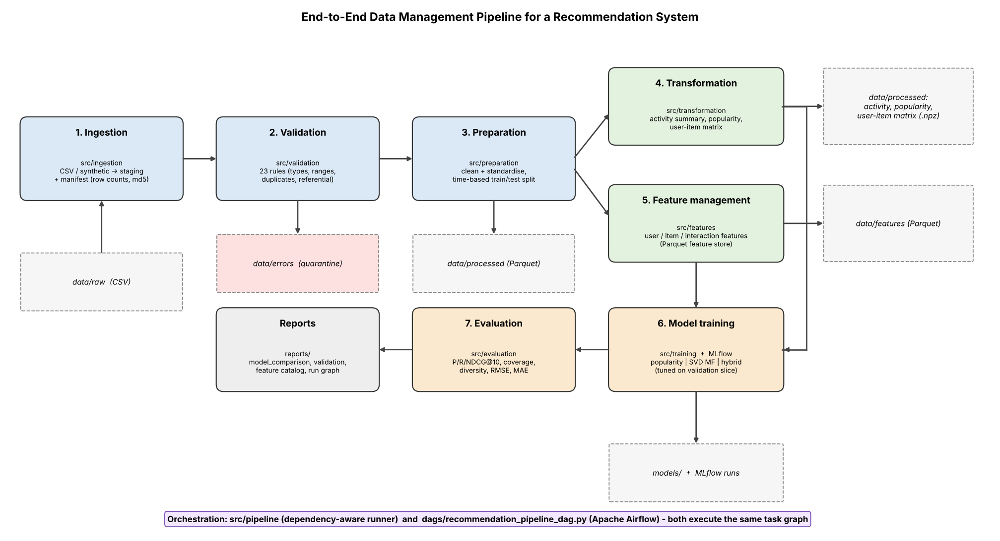

# End-to-End Data Management Pipeline for a Recommendation System

DM4ML - Assignment 2 | Individual submission | 2025AG05862.  
**GitHub repository:** https://github.com/2025ag05862-stack/S1-26_AIMLZG529-2025AG05862Assignment2

This project follows user, item and interaction data from raw CSV files to validated
data, features and recommendation results. The stages run through one workflow:

```
Ingestion -> Validation -> Preparation -> Transformation -+
                                  |                        +-> Training (MLflow) -> Evaluation
                                  +--> Feature Management -+
                       (all stages automated by one dependency-aware workflow: local runner + Apache Airflow DAG)
```



## Data

The pipeline runs on a **seeded synthetic dataset** (movie-style platform: ~1.5k users, ~600 items, ~40k ratings 1-5,
2022-2024) generated by `src/ingestion/generate_synthetic.py`. The generator uses latent preferences to assign ratings and intentionally adds missing fields, duplicates,
invalid ratings and dates, and unmatched user/item IDs. These are used to test the validation stage. The dataset
is synthetic, so model scores should not be interpreted as expected performance on a real movie service.

**To use another dataset:** prepare the three CSVs below and place them in `data/raw/`. This requires matching
column names and compatible values; a raw MovieLens file cannot be dropped in without mapping its columns first.

| file | columns |
|---|---|
| `users.csv` | `user_id, age, gender, country, signup_date` |
| `items.csv` | `item_id, title, category, genres (pipe-separated), release_year` |
| `interactions.csv` | `user_id, item_id, rating, timestamp` (`YYYY-MM-DD HH:MM:SS`) |

## Setup and installation

**Requirements:** Python 3.10–3.12 for the project; Python 3.12 was used in the verified WSL run. The project has its own dependencies in `requirements.txt`. Airflow is installed in a **separate** virtual environment on Ubuntu/WSL2.

Clone the repository. The source files are at the **repository root**, so do not append another `recommendation-pipeline` directory after cloning.

```bash
git clone https://github.com/2025ag05862-stack/S1-26_AIMLZG529-2025AG05862Assignment2.git
cd S1-26_AIMLZG529-2025AG05862Assignment2
python3 -m venv .venv
source .venv/bin/activate
python -m pip install --upgrade pip
python -m pip install -r requirements.txt
```

On Windows Command Prompt (for the Python pipeline only):

```cmd
py -m venv .venv
.venv\Scripts\activate.bat
python -m pip install -r requirements.txt
```

On PowerShell, activate with `.\.venv\Scripts\Activate.ps1` instead. For Apache Airflow on Windows, use **Ubuntu via WSL2** rather than installing native Windows Airflow.

## Run the recommendation pipeline

Run these commands from the repository root with the project `.venv` activated:

```bash
python -m src.pipeline.runner            # use the existing raw CSV input files
python -m pytest -q                      # unit tests (13 in this repository)
```

For a fully regenerated synthetic dataset and fresh results, use:

```bash
python -m src.pipeline.runner --fresh
```

**Note:** `--fresh` deletes generated data, models and local MLflow artifacts before regenerating them with the configured seed. It will overwrite earlier generated outputs. Do not use this flag when you want to preserve the existing run artifacts.

Optional reporting and experiment-tracking commands:

```bash
python -m src.reporting.make_architecture
python -m src.reporting.make_report
mlflow ui --backend-store-uri sqlite:///mlflow.db
```

The MLflow interface is normally available at `http://127.0.0.1:5000`. To execute a single stage, use, for example, `python -m src.pipeline.run_task validate` (its prerequisites must already exist).

## Apache Airflow orchestration (Ubuntu / WSL2)

The DAG file is `dags/recommendation_pipeline_dag.py` and its DAG ID is **`recommendation_pipeline`**. It reuses the dependency graph defined by `src/pipeline/graph.py` and invokes the project interpreter through `PIPELINE_PYTHON`. Separate environments avoid clashes between Airflow's constrained dependencies and the model-training libraries.

### 1. Install Apache Airflow 2.10.5

Open an Ubuntu/WSL terminal. The following commands assume the repository directory is already your working directory. If not, `cd` into its actual location first.

```bash
# From inside the repository root:
export PROJECT_ROOT="$(pwd)"

# The project environment must already have its requirements installed.
python3 -m venv "$HOME/airflow-env"
source "$HOME/airflow-env/bin/activate"

PYTHON_VERSION=$(python -c 'import sys;print(f"{sys.version_info.major}.{sys.version_info.minor}")')
python -m pip install "apache-airflow==2.10.5" \
  --constraint "https://raw.githubusercontent.com/apache/airflow/constraints-2.10.5/constraints-${PYTHON_VERSION}.txt"
```

### 2. Configure Airflow and start services

Set these environment variables **in the terminal that will run `airflow standalone`**:

```bash
export AIRFLOW_HOME="$HOME/airflow_home_dm4ml"
export PROJECT_ROOT="/absolute/path/to/the/cloned/repository"
export AIRFLOW__CORE__DAGS_FOLDER="$PROJECT_ROOT/dags"
export AIRFLOW__CORE__LOAD_EXAMPLES=False
export AIRFLOW__WEBSERVER__WEB_SERVER_PORT=8081
export PIPELINE_PYTHON="$PROJECT_ROOT/.venv/bin/python"

airflow standalone
```

Replace `/absolute/path/to/the/cloned/repository` with the actual Ubuntu/WSL path. If still inside the repository root, you can use `export PROJECT_ROOT="$(pwd)"` instead. **Always quote paths containing spaces.** The variables need to be set again in each new terminal session unless added to the shell configuration.

Airflow is configured for `http://localhost:8081`; this avoids the port-8080 conflict encountered during the verified execution. Use the local admin credentials created by `airflow standalone`. Keep this terminal open while using the dashboard.

### 3. Check DAG discovery and trigger a run

In another terminal, activate `~/airflow-env` and export the same `AIRFLOW_HOME`, `PROJECT_ROOT`, and `AIRFLOW__CORE__DAGS_FOLDER` values, then run:

```bash
airflow dags list
airflow dags list-import-errors
```

The expected DAG ID is `recommendation_pipeline`, with no import errors. In the Airflow web interface, unpause the DAG if necessary, click **Trigger DAG**, and inspect the **Graph** view. Task dependencies are:

```text
ingest -> validate -> prepare -> transform ------+
                              \-> build_features --+-> train -> evaluate
```

### Verified execution

- **Date:** 14 November 2026.
- **Environment:** Apache Airflow 2.10.5 on Ubuntu (WSL2), webserver port 8081.
- **DAG:** `recommendation_pipeline`, manually triggered.
- **Outcome:** All seven tasks succeeded: `ingest`, `validate`, `prepare`, `transform`, `build_features`, `train`, `evaluate`.
- **Evidence:** Save the actual Airflow Graph-view screenshot as `reports/airflow_success_2026-11-14.png` and commit it along with this README.

`reports/airflow_dag_run_graph.png` is an **automatically generated graph**; it is not a screenshot of the Airflow web interface. The latter is the appropriate execution evidence for the submission PDF.

## Repository structure

```
S1-26_AIMLZG529-2025AG05862Assignment2/
├── configs/config.yaml            # every threshold, path, seed and model hyper-parameter
├── data/
│   ├── raw/                       # immutable input CSVs (never modified by the pipeline)
│   ├── processed/                 # staging, validated, cleaned, train/test, derived datasets (Parquet / .npz)
│   ├── features/                  # materialised feature store (Parquet)
│   └── errors/                    # quarantined invalid records (+ rule name and reason)
├── src/
│   ├── common/                    # config + logging helpers
│   ├── ingestion/                 # generate_synthetic.py, ingest.py
│   ├── validation/                # validators.py (23 rules), run_validation.py
│   ├── preparation/               # clean.py, split.py (time-based), run_preparation.py
│   ├── transformation/            # derived.py (activity summary, item popularity, user-item matrix)
│   ├── features/                  # definitions.py (catalog), build_features.py, feature_store.py
│   ├── training/                  # models.py (popularity, SVD-MF, hybrid), train.py (+MLflow)
│   ├── evaluation/                # metrics.py, evaluate.py
│   ├── pipeline/                  # graph.py, tasks.py, runner.py, run_task.py
│   └── reporting/                 # architecture diagram, run graph, final PDF report
├── dags/recommendation_pipeline_dag.py   # Apache Airflow DAG
├── models/                        # trained models (.joblib) + MLflow run ids
├── reports/                       # all deliverable evidence (see table below)
├── tests/                         # pytest unit tests
├── Makefile, requirements.txt, README.md
```

## Where each deliverable lives

| Deliverable | Location |
|---|---|
| Source code in modules | `src/` |
| Setup / execution instructions | this README |
| `requirements.txt` | `requirements.txt` |
| Architecture diagram | `reports/architecture.png` |
| Data validation report / logs | `reports/validation_report.md` (+ `.json`, `validation_summary.csv`), quarantined rows in `data/errors/`, run log `reports/logs/pipeline.log` |
| Feature catalog (table) | `reports/feature_catalog.md` / `.csv` |
| Model evaluation results | `reports/model_comparison.md` / `.csv`, MLflow export `reports/mlflow_runs.csv` |
| Orchestration DAG / workflow | `dags/recommendation_pipeline_dag.py`, `src/pipeline/` |
| Successful-run evidence | `reports/pipeline_run_graph.png` and `reports/pipeline_run.json` (local runner); `reports/airflow_run_evidence.txt` (Airflow logs); `reports/airflow_success_2026-11-14.png` (actual Airflow UI screenshot, to be added). The existing `reports/airflow_dag_run_graph.png` is generated, not a UI screenshot. |
| Generated technical report | `reports/final_report.pdf` (2-page technical report generated from pipeline results). The **separate submission PDF** should additionally contain stage screenshots and the GitHub URL. |

## What each stage does

1. **Ingestion** - reads CSVs as strings (nothing silently coerced), enforces the expected schema, writes staging
   Parquet and a manifest (row counts, MD5).
2. **Validation** - 23 rules: missing values, duplicates, data types, rating range, timestamp validity/range,
   referential integrity. *Error* rules quarantine the row into `data/errors/`; *warning* rules keep the row and log it.
3. **Preparation** - standardises gender / country / category, imputes missing age & year (flagged), keeps the latest
   rating per (user, item), and creates a **time-based** train/test split (latest 20% of time = test).
4. **Transformation** - user activity summary, item popularity, sparse user-item matrix (train only).
5. **Feature management** - 18 documented user / item / user-item features in a small Parquet feature store whose
   `FeatureStore` class serves both training and prediction (recency features recomputed for any as-of time).
6. **Training** - popularity baseline, SVD matrix factorisation, hybrid (MF + feature-store category affinity).
   Latent-factor count is selected on a validation slice cut from the training period only. Params / metrics / models
   are tracked in MLflow.
7. **Evaluation** - Precision@10, Recall@10, NDCG@10, coverage, diversity, RMSE, MAE on the held-out future period.

## Results (K = 10, test = latest 20% of interactions)

| Model | P@10 | R@10 | NDCG@10 | Coverage | Diversity | RMSE | MAE |
|---|---|---|---|---|---|---|---|
| Popularity baseline | 0.0861 | 0.2247 | 0.1862 | 0.0583 | 0.8319 | 0.8339 | 0.6757 |
| SVD matrix factorisation | 0.1151 | 0.2931 | 0.2463 | 0.1467 | 0.7749 | 0.7547 | 0.5961 |
| Hybrid (MF + features) | 0.1143 | 0.2868 | 0.2462 | 0.1850 | 0.7502 | 0.7547 | 0.5961 |

The personalised models beat the baseline on accuracy. The hybrid does not improve on plain MF accuracy (it widens
catalogue coverage at some cost in diversity). Because the data is synthetic, absolute numbers are illustrative -
see the limitations section of `reports/final_report.pdf`.

## Reproducibility

* One config file, fixed seeds, immutable raw data, Parquet intermediates.
* `python -m src.pipeline.runner --fresh` regenerates the synthetic data, models and outputs using the same configured seed. The repository includes successful local-run records and Airflow task-state evidence; the verified real UI screenshot should be committed separately.
* Task dependencies are defined once (`src/pipeline/graph.py`); the local runner and the Airflow DAG both use it.

## Notes for review

The project contains generated execution logs and MLflow CSV exports from the machine where it was first run.
Absolute file paths in those records refer to that machine; they are not required to execute the project.
To verify a new run, use the commands above and inspect the newly generated files.
The Airflow task-state graph is **not** a screenshot of the Airflow user interface. Add `reports/airflow_success_2026-11-14.png` from the actual successful Airflow run before final submission. Do not commit passwords, tokens or local virtual environments.
